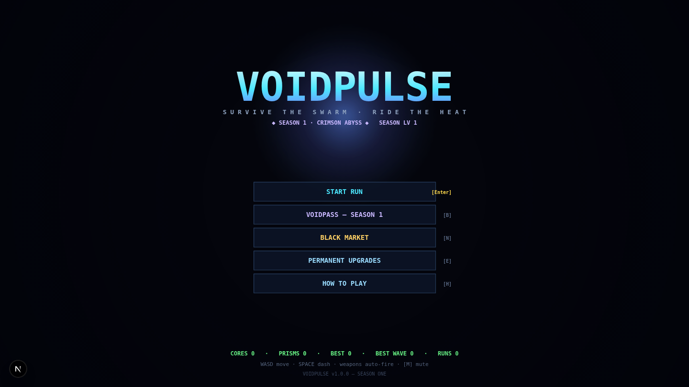

# VOIDPULSE

**VOIDPULSE** is a fast, neon-soaked arena survivor roguelite that runs entirely in your browser. Pilot a lone combat hull inside the VOID, shred escalating swarms, collect XP cores, build absurd weapon synergies, and survive the Leviathan at the end of the run — then spend what you earned in the market and grind the VOIDPASS season.

> Current version: **v1.3.0**



## Gameplay

- **Core loop** — survive escalating waves in a 2400×2400 arena, vacuum up XP cores, level up mid-run, pick weapon/passive cards, and kill everything before it kills you.
- **Weapons & evolutions** — 10 weapons across 5 levels each, supercharged evolutions unlocked via a paired passive — including the dual-weapon **GLACIER FAN** (Scatter Bolt + Cryo Field).
  - **Rail Driver** — hit-scan slugs that pierce everything on the line (evolves into RAILSTORM's 3-slug fan).
  - **Tether Harpoon** — hooks and reels in hostiles, stunned and sorry (evolves into LEVIATHAN HOOK's slam).
  - **Mirror Blade** — melee arc that shreds swarms and reflects enemy bullets back as counter-fire (evolves into PRISM WARD).
- **Relics** — at wave 3 the void offers a bargain: **Vampire Sigil** (kills heal, orbs halved), **Overclock Core** (+25% fire rate, periodic jams) or **Void Pact** (+1 module slot, one fewer weapon slot). One per run, no refunds.
- **Drone bay** — buy a companion drone once in the market, deploy it every run: **Magnetite** reels in shards, **Lumen** zaps the nearest hostile, **Aegis** raises a 1-hit barrier at each wave start.
- **Bosses** — mid-run and finale bosses (including **The Leviathan**) with telegraphed attack patterns.
- **Elite affixes** — every elite rolls 1–2 affixes (Burst, Swift, Shield, Thorns, Vampiric, Frost Aura, Explosive, Mirror) shown as colored pips; richer affixes pay better.
- **Combo meter** — chain kills within 2s; 10/25/50 slams RAMPAGE / VOIDSTORM / ASCENDANT banners and long chains pay bonus Cores at run end.
- **Anti-stall valve** — if a wave's cleanup drags (heal-stacked swarms), THE VOID HUNGERS: escalating decay guarantees the run always moves.
- **Difficulty** — medium-to-hard, easy to understand: simple controls, deep build decisions, a real win condition and a real lose condition.

## Meta progression (Season One)

- **VOIDPASS** — a dual-track seasonal battle pass:
  - **Free track** — earns Cores, skins, and other rewards just by playing.
  - **PRIME track** — unlockable with Prisms (simulated in-game purchase); premium cosmetics and bigger payouts on every tier.
- **Market** — spend hard-earned currency across three hubs:
  - **Shipwright & Drone Bay** — skins and companion drones.
  - **Supply Depot** — consumable boosters.
  - **Exchange** — convert Cores → Prisms and acquire PRIME.
- **Currencies** — **Cores** (soft, earned in runs) and **Prisms ◇** (premium, from the pass, contracts and the exchange).
- **VOID DIAL** — pre-run mutation toggles (Cursed Cores, Glass Hull, Swarm Protocol, Iron Man); stack 3+ to earn the ×1.5 BP **MUTANT** bonus.
- **DAILY BREACH** — a date-seeded run with 2 fixed mutations; personal-best stamp and a one-time 60◇ completion prism. No leaderboard — you race your own ghost.
- **Achievements** — 25 lifetime milestones across 4 tiers paying Cores/Prisms, with a full progress screen.
- **Skins & meta perks** — persistent cosmetics and run-modifier perks that survive death.
- Progress is saved locally between sessions.

## Tech stack

| Layer      | Tech                                        |
| ---------- | ------------------------------------------- |
| Framework  | Next.js 16 (App Router) + React 19          |
| Language   | TypeScript                                  |
| Rendering  | Canvas 2D, fixed-timestep loop, all art procedural |
| Audio      | WebAudio, procedurally synthesized SFX/music |
| Styling    | Tailwind CSS 4 + shadcn/ui                  |
| Data       | Prisma ORM + SQLite                         |

No game engine, no image assets — every sprite, effect and sound is generated in code.

## Getting started

Requires [Bun](https://bun.sh) (or Node 20+) and a system with a modern browser.

```bash
# 1. install dependencies
bun install        # or: npm install

# 2. set up the database (local SQLite)
bun run db:push    # or: npm run db:push

# 3. run the dev server
bun run dev        # or: npm run dev
```

Open **http://localhost:3000** and press start.

### Production build

```bash
bun run build
bun run start
```

## Controls

| Input            | Action                          |
| ---------------- | ------------------------------- |
| `W` `A` `S` `D`  | Move                            |
| `Space`          | Dash                            |
| `P` / `Escape`   | Pause / back                    |
| Mouse            | Menus, card picks, market       |

## Project layout

```
src/
  app/            Next.js app router entry
  components/     GameCanvas host component + UI kit
  game/
    content.ts    Balance database (weapons, enemies, pass, market)
    game.ts       Core game state machine & update loop
    combat.ts     Damage, collisions, enemy AI behaviors
    waves.ts      Wave director / spawn logic
    bosses.ts     Boss definitions & patterns
    economy.ts    VOIDPASS, contracts, market, currencies
    cards.ts      Level-up card pool & drafting
    skins.ts      Cosmetic definitions
    render.ts     Canvas renderer
    renderUI.ts   HUD & screen rendering
    audio.ts      Procedural WebAudio engine
    save.ts       Local persistence
  lib/db.ts       Prisma client
prisma/           Schema
download/         Screenshots
```

## License

All rights reserved by the author. Built with autonomous AI game design — v0.5.0 → v1.0.0.
